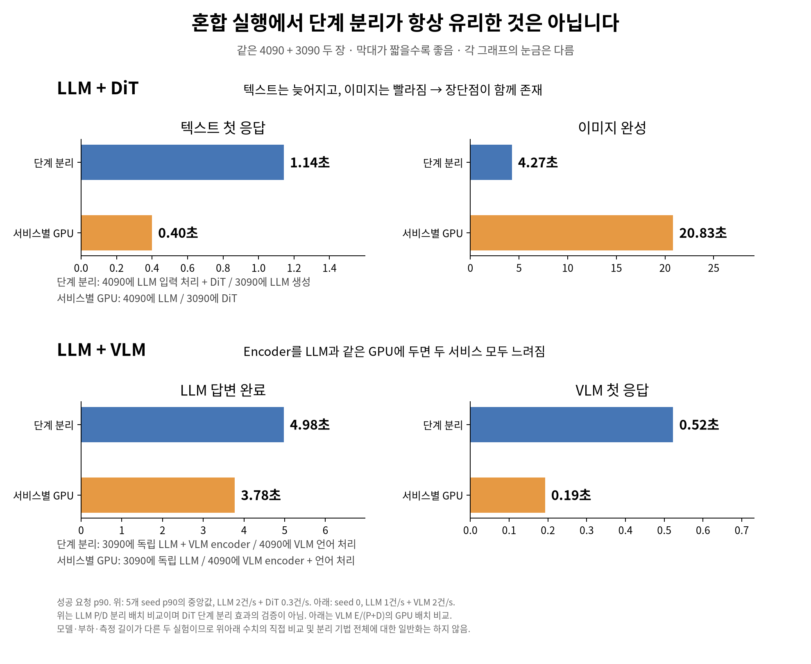

# mllm — 고정 이종 GPU의 혼재 추론 연구

LLM-PILOT을 LLM·VLM·DiT가 함께 실행되는 멀티모달 추론 환경으로 확장한다. 서비스별 SLO를 만족하도록 모델별 분할 전략·단계 배치·GPU 자원 구성을 선택하고, 주어진 서비스 수요를 충족하는 자원 비용을 최소화하는 것이 최종 목표다.

## 최신 연구 현황 — 2026-10-15 정리

**최신 완료 실험 기록: 2026-10-14.** 아래 항목이 현재 연구의 최신 실측이다.

- **LLM+DiT:** 4090+3090에서 LLM P/D 분리 배치와 서비스별 GPU 배치를 seed 0–4로 비교했다. 텍스트 첫 응답과 이미지 완료 사이의 trade-off를 관측했다. DiT 자체의 단계 분리 효과를 검증한 실험은 아니다.
- **LLM+VLM:** VLM encoder와 독립 LLM의 GPU 공유 및 encoder 배치 변경을 비교했다. 단독 기준·혼합 실행 비교와 4개 부하 × 2개 배치 실험을 완료했다(seed 0). 해당 부하 범위에서는 VLM 단계들을 4090에 모은 배치가 주요 지연 지표에 유리했다.
- **현재 검증 범위:** 두 서비스 조합의 공유 실행·배치 효과까지 확인했다. 세 모델 동시 실행, SLO 기반 최종 solver 및 비용 절감 효과의 검증은 남아 있다. GPU 속도·전송·공유 실행 효과를 구분해 해석한다.

### 실행 코드와 결과

저장소 루트에서 실행한다. GPU 실험은 두 GPU를 사용하며, 기존 출력 보호와 완료 실행 건너뛰기 동작이 있으므로 재실험 시 출력 설정을 확인한다.

| 실험 | 실행 진입점 | 결과 |
|---|---|---|
| LLM+DiT 반복 비교 | `python bench/hetero/run_controlled_batch.py` → `run_mixed_modal.sh` | [반복 실험 보고서](results/hetero/controlled_runs/comparison.md) |
| LLM+VLM 배치 비교 | `python bench/hetero/vlm/run_placement_study.py` → `run_interference_pilot.py` | [배치 비교](results/hetero/vlm_placement_seed0/comparison.json) |
| LLM+VLM 부하 변화 | `python bench/hetero/vlm/run_placement_study.py --load-sweep` | [부하별 비교](results/hetero/vlm_placement_load_sweep_seed0/comparison.json) |
| 요약 그림 생성 | `python bench/hetero/plot_mixed_summary.py` | [그림 수치](results/hetero/mixed_summary/plotted_values.json) |

세부 조건·한계·후속 과제는 [연구 및 실험 기록](docs/solver_need_experiments.md)을 따른다.

## 연구 기록

- [연구 배경·미팅 기록](docs/1013_meeting.md)
- [실험 조건·진행 결과·한계](docs/solver_need_experiments.md)
- [연구 환경](docs/research_env.md)

이 업데이트는 최신 연구 코드·문서·결과를 담는다. 대용량 profiler trace와 실행 로그, 외부 논문 자료 및 이전 연구의 폴더 재배치는 포함하지 않는다.
