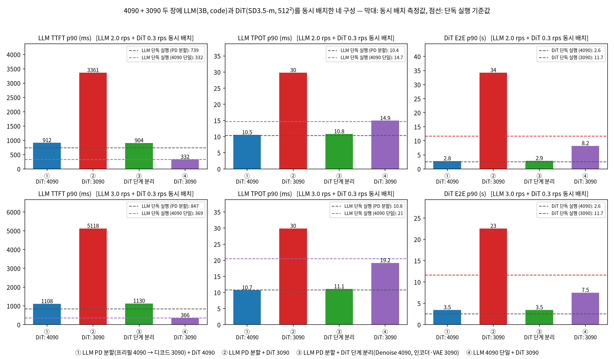
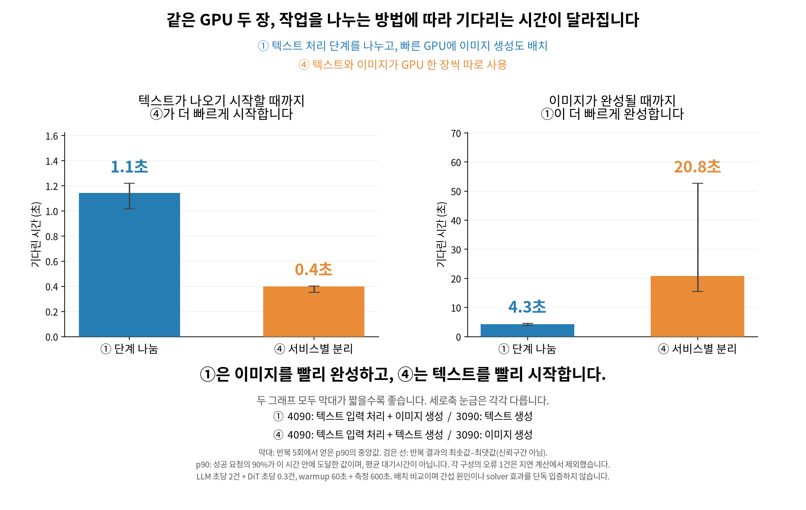
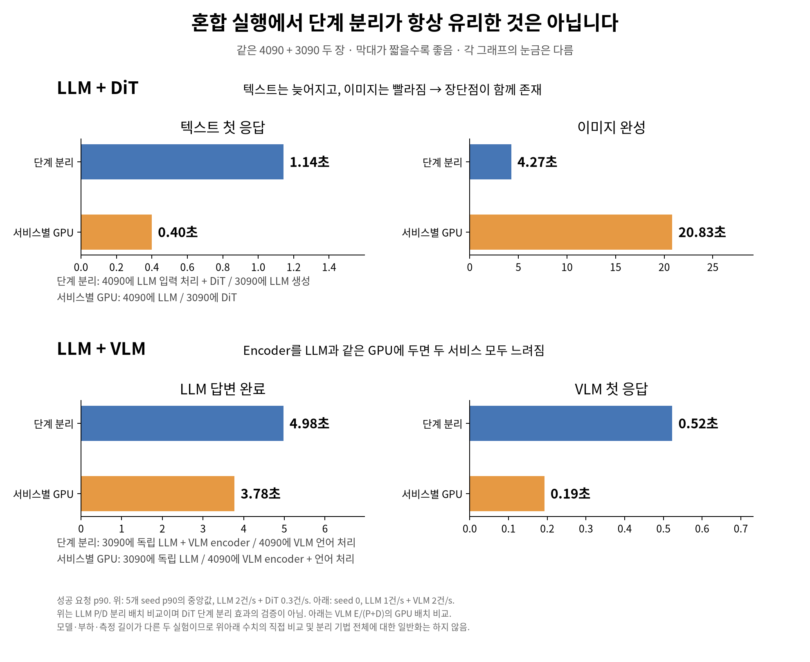

# 10/13 주간 미팅 — 혼재 추론의 간섭과 구성 선택

## 이번 주 핵심

**고정된 4090+3090에서 LLM과 DiT를 함께 실행하면, 단독 실행에서의 장점이 보존되지 않는다. 어떤 단계끼리 GPU를 공유하는지에 따라 두 서비스의 지연이 크게 달라진다.**

연구의 출발점을 “solver를 만든다”에서 **“어떤 상황에서 구성 선택이 필요하고, 간단한 고정 배치가 왜 부족한가?”**로 바꾼다. SLO와 비용도 이 질문에 맞춰 다시 정의한다.

현재까지 확인한 것:

1. **간섭:** LLM decode와 DiT를 3090에서 공유하면 양쪽 지연이 악화된다.
2. **완화:** DiT를 4090으로 옮기면 decode 지연이 단독 수준에 가까워진다.
3. **선택 필요성의 초기 근거:** 동일한 부하에서도 요구 조건에 따라 통과 가능한 구성이 달라진다.
4. **아직 확인하지 못한 것:** 반복 실험의 유의성, 동적 solver의 이득, 전환 비용, VLM 포함 결과, 구매비 절감.

## 1. 무엇을 연구하는가

하나의 멀티모달 모델 내부뿐 아니라 **독립적인 LLM·VLM·DiT 서비스를 고정된 이종 GPU 풀에서 함께 운영하는 상황**을 대상으로 한다.

> 단계별 자원 특성과 간섭이 다른 서비스들을 함께 실행할 때, 분리·공유·배치·실행 순서를 어떻게 선택해야 각 서비스의 요구를 함께 만족시킬 수 있는가?

| 서비스 | 단계 | 요청 크기를 결정하는 변수 |
|---|---|---|
| LLM | Prefill → Decode | 입력·출력 길이, batch, KV 크기 |
| VLM | Vision encode → Prefill → Decode | 이미지 수·해상도, 시각 토큰, 출력 길이 |
| DiT | Text encode → Denoise → VAE | 해상도, step 수, batch |

LLM의 PD 분할은 prefill/decode의 서로 다른 요구와 간섭을 다룬다. VLM의 EPD 분할은 encoder를 추가로 분리한다. DiT의 단계 분리는 단계별 메모리·연산 요구와 병렬도 차이를 다룬다. **이 기법들의 이득은 해당 논문의 모델·장비·부하 조건에서 얻은 결과이며, 혼재 환경에서도 자동으로 유지되는 보장은 없다.**

기존 초안의 “싼 decode 카드면 충분”, “encoder 분리 시 메모리 15배·batch 22배” 등은 보편적 사실로 사용하지 않는다. 정확한 실험 조건과 출처를 확인한 뒤 비교한다.

## 2. 현재 실험: 단계 조합에 따라 간섭이 다르다

조건: 4090+3090, Llama-3.2-3B-Instruct, code 길이 trace, SD3.5-medium 512×512·28 steps. DiT는 T5 encoder 없이 실행하며 FIFO·batch 1이다. LLM GPU 메모리 비율은 0.5로 고정했다. VLM은 아직 실측하지 않았다.

| 구성 | 4090 | 3090 |
|---|---|---|
| ① C_4090 | LLM prefill + DiT 전체 | LLM decode |
| ② C_3090 | LLM prefill | LLM decode + DiT 전체 |
| ③ C_split | LLM prefill + DiT denoise | LLM decode + DiT encoder·VAE |
| ④ S4_3090 | LLM prefill·decode | DiT 전체 |

LLM 2 rps + DiT 0.3 rps에서 ②의 단독 대비 악화:

| 지표 | 같은 구성의 단독 실행 | ② 혼재 | 비율 |
|---|---:|---:|---:|
| LLM TTFT p90 | 739 ms | 3,361 ms | 4.55배 |
| LLM 요청 평균 TPOT p90 | 10.4 ms | 29.8 ms | 2.87배 |
| DiT E2E p90 | 11.66 s | 34.21 s | 2.93배 |

**PD 분할의 decode 이점이 역전된다.** 단독에서는 PD의 TPOT가 4090 단일 실행보다 좋지만(10.4 vs 14.7 ms), ②에서는 29.8 ms로 올라가 ④의 14.9 ms보다 느려진다. TTFT는 PD 단독에서도 불리하므로 “TTFT 우위까지 사라졌다”고 주장하지 않는다.

②에서 ①로 배치를 바꾸면 TTFT는 912 ms, TPOT는 10.5 ms, DiT E2E는 2.81 s가 된다. 같은 두 GPU로 큰 차이가 발생한다.

### 실행시간 증가가 큐잉을 증폭시킬 수 있다

3090 DiT denoise 평균은 단독 2.85 s에서 공유 시 4.32–4.59 s로 늘어난다. 도착률 0.3 rps에서 `도착률 × denoise 시간`은 약 0.85에서 1.30–1.38로 올라간다. FIFO·batch 1에서 이 상태가 지속되면 처리 용량을 넘어 큐가 쌓인다. 이는 정상상태 용량의 확정값이 아니라, 관측된 큐잉 악화를 설명하는 진단이다.

연산·메모리 대역폭·커널 경쟁 중 어떤 원인이 지배적인지는 아직 추가 계측이 필요하다. **③은 ①과 거의 같아서 현재 조건에서 단계 분리 자체의 큰 이득은 확인되지 않았다.**

### 현재 결과의 한계

- LLM은 300건이지만 DiT는 LLM 1/2/3 rps에 따라 90/45/30건이고 단독은 60건이다.
- 동일 seed라도 관측 구간과 도착 시퀀스 길이가 다르다. 부하 증가 시 DiT p90이 줄어드는 현상을 개선으로 해석하지 않는다.
- 공통 시작 barrier와 반복 seed가 없다. 통계적 유의성 및 지속 가능한 용량은 아직 미확인이다.
- ④의 DiT가 단독보다 빨라 보이는 결과도 표본·관측 구간 차이를 먼저 통제해야 한다.
- TPOT는 요청별 평균 토큰 간격이다. 개별 토큰 간격의 tail이나 긴 멈춤을 직접 측정한 값은 아니다.

원시 결과: [혼재 summary](../../results/hetero/mixed_modal/summary.md).

## 3. SLO: 서비스 요구에서 출발한다

먼저 특정 SLO 없이 지연 분포, 단계별 실행·대기, 큐 증가, 처리량을 측정한다. 그 뒤 사용자에게 중요한 완료 시점을 요구 조건으로 정의한다.

| 시나리오 | 중요한 지표 |
|---|---|
| 대화형 LLM·VLM | 첫 응답 시간 + 생성 중 끊김 |
| 코드 생성·문서 분석 | 완성 답변까지의 E2E, 길이별 지연 |
| 대화형 이미지 생성 | 완성 이미지까지의 E2E |
| 비동기 이미지 작업 | 완료 deadline과 처리량 |

VLM TTFT에는 요청 도착부터 이미지 처리·큐잉·prefill을 거쳐 첫 토큰이 나올 때까지를 포함한다. 단계별 예산은 내부 제어용이고 서비스 SLO는 요청 전체 기준이다.

실제 요구 자료가 없으면 숫자를 서비스 표준으로 주장하지 않는다. **여러 deadline·attainment 목표를 사후 채점하여 민감도를 보고한다.** 단독 대비 slowdown은 간섭 진단용이며 사용자 SLO와 구분한다.

LLM은 동일 요청이 TTFT와 TPOT 조건을 함께 통과해야 한다. 각 지표 p90을 따로 통과하는 것은 joint attainment 90%를 보장하지 않는다. 오류·거절·관측 종료 시 미완료 요청을 성공 분모에서 제외해 점수를 높이지 않는다. 성공 종료까지 추적하거나 censoring을 명시한다.

서비스별 만족률을 각각 보고한다. 서로 다른 크기의 LLM 요청과 이미지 요청을 무조건 합산한 goodput으로 한 서비스의 실패를 가리지 않는다.

## 4. 비용: 우선 고정 자원의 서비스 용량

**동일한 GPU를 같은 시간 사용하면 배치 변경만으로 구매비·임대비가 감소하지 않는다.** 현재 연구의 주목적은 같은 장비로 더 넓은 수요 영역을 감당하는 것이다.

| 상황 | 목적 | 필요한 근거 |
|---|---|---|
| 기존 고정 GPU 풀 | 서비스 용량 확대 | 서비스별 요구를 만족하는 수요 영역 |
| 전력 비용을 줄이는 운영 | 에너지 최소화 | 동일 수요·관측 시간의 전력 적분 |
| 구매·클라우드 증설 | 필요 자원 비용 최소화 | 동일 수요를 만족하는 최소 자원 구성 |

“3090 보유, 4090 신규 구매”는 별도 시나리오로 남긴다. 추가 GPU 구성의 실측 또는 검증된 모델 없이 구매비 절감을 주장하지 않는다. 평균 W만으로 에너지 절감을 주장하지 않는다.

## 5. Solver 필요성: 첫 분석을 시작했다

### 적절한 시작점에 대한 판단

**기존 데이터에서 고정 배치의 한계부터 확인하는 것이 가장 적절하다.** 새 solver 구현이나 VLM 전체 통합보다 먼저, 구성 선택 자체가 결과를 바꾸는지 확인할 수 있다.

[분석 코드](../../bench/hetero/analyze_solver_need.py)는 네 구성·여섯 부하의 requests.csv를 직접 채점한다. 탐색 deadline은 TTFT {0.3, 0.5, 1, 2}s, 평균 TPOT {12, 20, 30, 50}ms, DiT E2E {3, 5, 10, 20}s이다. 각 서비스에서 90% 이상 만족해야 통과한다. 오류·비유한 값은 실패로 포함한다.

**아래 기준들은 실제 사용자 요구가 아니라 구성 선택 가능성을 조사하는 탐색 기준이다.** 특히 12/20 ms는 관찰된 성능 범위를 조사하기 위한 값이다.

동일한 LLM 2 rps + DiT 0.3 rps에서도 요구 조건에 따라 선택이 달라진다:

| 탐색 요구 | ① LLM/DiT 만족률 | ④ LLM/DiT 만족률 | 네 후보 중 통과 구성 |
|---|---:|---:|---|
| TTFT≤0.5s, TPOT≤20ms, DiT≤10s | 65.7% / 100% | 93.7% / 97.8% | ④만 통과 |
| TTFT≤1s, TPOT≤12ms, DiT≤3s | 92.3% / 93.3% | 85.0% / 31.1% | ①만 통과 |

두 번째 사례에서 ③의 LLM 만족률은 89.7%여서 경계에 가깝다. ①의 독점적 우위를 확정하려면 반복 측정이 필요하다.

전체 384개 탐색 조합 중 하나 이상의 구성이 통과한 것은 202개다. 통과 영역이 가장 넓은 고정 배치 ①은 164개를 통과한다. 조합마다 구성을 고를 수 있다고 가정하면 나머지 38개 영역에도 대응할 여지가 있다. **이는 열거한 조합의 개수이며, 실제 goodput 향상률이나 온라인 solver 효과가 아니다.**

전체 보고서: [solver 필요성 분석](../../results/hetero/solver_need/summary.md), [상세 JSON](../../results/hetero/solver_need/analysis.json).

### 주장 수준을 구분한다

| 주장 | 현재 상태 | 다음 입증 |
|---|---|---|
| 공유 시 간섭이 발생한다 | 큰 악화 관측 | 동일 구간·반복 실험 |
| 요구에 따라 구성 선택이 필요하다 | 탐색적 근거 있음 | 요구 범위·반복 seed에서 재현 |
| 수요 변화에 온라인 재선택이 필요하다 | 미입증 | 동일 trace 내 전환 + 최선 고정 배치 비교 |
| 배치와 실행 제어를 공동 최적화해야 한다 | 미입증 | 배치만/제어만/공동 선택 비교 |
| 복잡한 최적화 알고리즘이 필요하다 | 미입증 | 후보 증가 시 전수 탐색·lookup의 비용과 품질 비교 |

후보 네 개라면 전수 탐색이나 lookup도 유효한 solver다. 알고리즘 복잡도를 연구 기여로 먼저 정하지 않는다.

## 6. 다음 실험과 통과 기준

1. **측정 통제:** 공통 시작 시점, 동일 시간 길이, 동일 요청 도착·크기 시퀀스를 모든 구성에 적용한다. 독립 seed를 반복하고 실행 순서를 섞는다. 양쪽 부하가 실제 겹친 구간을 기록한다.
2. **고정 배치 한계 재현:** 우선 ①과 ④의 상반된 요구 영역을 반복 측정한다. 현재 네 구성은 모두 기준선으로 유지한다. 경계 결과는 신뢰구간과 서비스별 만족률로 확인한다.
3. **수요 지도:** LLM 입력·출력 길이, DiT 도착률·해상도를 바꿔 지연 trade-off와 큐가 증가하지 않는 영역을 그린다. 단독부터 과부하인 경우와 공유 때문에 과부하로 바뀐 경우를 구분한다.
4. **단순 규칙 비교:** 최선의 고정 배치, DiT→4090 규칙, 큐 기반 greedy, 단독 프로파일 선택기, 실측 lookup과 비교한다. 학습·프로파일 trace와 평가 trace를 분리한다.
5. **온라인 필요성:** 평균 수요가 같은 trace에서 동시 burst·시간차 burst·수요 전환을 비교한다. 변경 비용을 포함해 최선 고정 배치보다 좋아지는지 확인한다. 독립 실행 결과를 이어 붙여 온라인 이득으로 제시하지 않는다.
6. **VLM 확장:** 가능하면 동일 backbone의 text-only와 image+text를 비교한다. encoder 실행과 늘어난 prefill의 영향을 분리하고 마지막으로 3종 혼재를 평가한다.

동적 전환은 가중치 상주, KV 이동, in-flight 요청 drain, warmup과 메모리 피크를 포함한다. 실제로 가능한 행동만 후보로 넣는다. 초기에는 서비스 재배치보다 routing·동시성 제한처럼 작은 제어부터 검토한다.

## 7. 초기 solver 설계와 평가

- 입력: 서비스별 수요·요청 크기, 큐 상태, 요구 조건, GPU 메모리·전송 제약.
- 선택: 결합/분리, 단계 배치, routing, 제한된 batch·동시성 옵션.
- 예측: 공유 시 실행시간 + 큐 지연 + 전송·전환 비용.
- 출력: 요구를 만족하는 후보와 예상 여유 용량. 후보가 없으면 infeasible로 보고한다.

고정 자원에서는 기준 수요 벡터 λ의 비율을 유지하며 αλ를 얼마나 크게 처리할 수 있는지 평가할 수 있다. 서비스별 attainment 목표를 제약으로 두고, 특정 서비스를 희생해 총 요청 수만 늘리지 않는다.

예측 평균 오차 외에 **선택한 구성의 실제 성능 손실, SLO 통과를 잘못 예측한 빈도, 탐색·프로파일 비용**을 평가한다. pairwise 간섭을 단순 합산하는 모델은 3종 혼재에서 검증하고, 오차가 실제 선택을 바꾸는지 확인한다.

## 8. 기존 연구와 차별점 후보

- [DistServe](https://arxiv.org/abs/2401.09670): LLM PD 분리와 goodput 중심 최적화.
- [EPDServe](https://github.com/vbdi/epdserve): 멀티모달 모델의 encode–prefill–decode 분리.
- [DDiT](https://arxiv.org/abs/2506.13497): diffusion 단계의 동적 자원 할당과 step 단위 스케줄링.
- [HorizonServe](https://arxiv.org/abs/2608.01785): 단일 GPU omni-model의 이질적인 SLO와 GPU 공유 제어.

차별점 후보는 **독립적인 LLM·VLM·DiT 서비스가 고정된 이종 GPU 풀을 공유할 때, 간섭·큐잉·전환 비용을 고려해 단계 분리·배치·실행 제어를 공동 선택하는 것**이다. 기존 연구에 없는 문제라는 확정 주장은 상세 비교 후 한다.

## 미팅에서 합의할 방향

- 주목적: 고정된 이종 GPU의 서비스 수용 능력. 에너지는 보조 지표, 구매비는 후속 평가.
- 첫 단계: 기존 데이터의 구성 선택 근거 → 측정 통제 후 재현.
- 동적 solver와 VLM 확장은 고정 배치의 한계가 재현된 뒤 진행한다.
- 한 구성이 계속 우세하거나 간단한 규칙으로 충분하면, 그 사실에 맞춰 연구 범위를 수정한다.

오프라인 분석 당시에는 샌드박스의 GPU 접근 제한으로 nvidia-smi 실행이 실패했다. 아래 후속 기록에서 GPU 접근을 해결했다. 위 분석 자체는 기존 CSV의 오프라인 분석이다.

## 후속 작업: 통제된 재측정 준비

공통 시계로 두 서비스를 재생하는 도구와 CONTROLLED_PLAN 실행 모드를 추가했다. seed 0–4의 동일 시간 계획을 준비했고, warmup 제외·오류·미완료 처리·계획 재현성을 CPU 모의 서버로 검증했다. 자세한 명령과 한계는 [실험 프로토콜](solver_need_experiments.md#1013-구현검증-상태)에 기록했다.

**최초 준비 당시 GPU 접근 실패로 새 성능 결과가 없었다.** 기존 실측에서 요구별 선택이 달라지는 초기 근거까지 확인했으며, 통제된 반복 실험에서 재현된다는 판정은 보류한다.

## GPU 실험 시작: 샌드박스 접근 문제 해결

드라이버를 재설치하지 않고 GPU 접근 가능한 실행 환경에서 확인했다. NVIDIA 575.57.08 드라이버와 CUDA는 정상이며 4090·3090 모두 유휴 상태였다. 로컬 Llama 3.2 3B tokenizer도 확인했다.

PD 프록시의 health endpoint가 /healthcheck인 점을 실제 통합에서 확인하고 fallback을 추가했다. 첫 setup 실패 로그는 controlled_runs/C_4090/seed0_setup_failed에 보존했다. 측정 요청 이전 실패이므로 성능 결과로 사용하지 않는다.

① C_4090 seed0의 warmup 및 본 관측 요청 송신을 확인했다. 첫 100개 완료 요청 오류는 0개였으며 이는 시작 상태 점검이지 최종 성능 결과가 아니다. 완료 요청은 requests.live.jsonl에 즉시 기록한다.

①·④ 각각 seed 0–4, 총 10개 실행을 순차 실행 관리 세션에 연결했다. seed별 구성 순서를 섞고 동일 GPU에서 동시에 다른 실험을 실행하지 않는다. 완료 시점에 [비교 보고서](../../results/hetero/controlled_runs/comparison.md)를 자동 갱신한다. 아직 실행 중인 결과를 완료된 반복 실험의 결론으로 해석하지 않는다.

진행 상태: results/hetero/controlled_runs/batch_status.json. 실제 실행 manifest·CSV·로그는 구성별 seed 폴더에 저장한다. 이 비교에서 다루지 않은 단독 기준·다른 부하·온라인 전환은 후속 실험이다.

## 현재 연구 초점과 VLM 기능 검증 시작

사용자와 합의한 목적은 **혼재 환경에서 각 단계의 성능을 훼손하는 충돌·병목을 포착하고, 하나의 제어 장치로 불필요한 성능 악화를 줄이는 것**이다. 특정 SLO에서 하나의 배치만 통과하는 사례를 만드는 것은 목표가 아니다. 배치 trade-off와 제어에 의한 성능 경계 개선을 평가한다.

연구 대상 LLM·VLM·DiT는 모두 유지한다. 현재 제한된 GPU 환경의 다음 실험에서는 DiT 대신 VLM encoder를 이용해 분리·공유·제어 가능성을 확인한다. DiT 512² 단계 분리는 메모리 확장성 이점보다 단계 이동의 간섭·전송 순효과를 관찰하는 보조 실험으로 해석한다.

설치된 vLLM 0.28의 mm_encoder_only, EC producer/consumer 및 ECExampleConnector 구현을 확인했다. 로컬 VLM이 없어 공개 Qwen2-VL-2B-Instruct 모델 다운로드를 시작했다. 이후 3090 encoder → 4090 prefill/decode 분리 smoke를 순차 실행하도록 연결했다. 아직 실제 분리 추론 성공을 확정하지 않는다.

[실행 안내](../../archive/legacy/vlm-2026-10/bench/vlm/README.md), [진행 상태](../../archive/legacy/vlm-2026-10/results/vlm_encoder_check_status.json). 먼저 이미지 응답·encoder cache 전달·consumer 재인코딩 여부를 확인하고, 다음에 공유 간섭과 encoder 실행 허용 제어를 시험한다. 기능 검증 단계의 파일 전달 시간을 최적화 성능으로 해석하지 않는다.

## 반복 실험의 지연 trade-off 시각화

서비스별 GPU 분리는 첫 응답이 빠르고, PD 분리·DiT 4090은 DiT 완료와 평균 토큰 생성이 빠르다. 따라서 모든 LLM 지표와 DiT 지표가 반대 방향이라는 뜻은 아니다. 점 하나는 seed별 성공 요청의 p90이며 신뢰구간이 아니다. 오류 처리와 관측 조건은 그림 하단에 명시했다.

## LLM–VLM 제어 파일럿 실행 시작

VLM E/(P+D) 기능 검증 이후, 3090에서 encoder와 독립 LLM을 공유하는 7조건 파일럿을 시작했다. 단독 부하 기준은 모든 모델의 메모리가 상주한 상태다. primer 동시성 1 제한의 영향과 무제어 공유를 비교한다. 자세한 조건·측정 한계는 [실험 계획](solver_need_experiments.md#llmvlm-공유-간섭encoder-실행-허용-제어-파일럿)을 참고한다. 결과는 완료 전 결론으로 해석하지 않는다.

## 연구 포지셔닝 명확화: LLM-PILOT의 멀티모달 플랫폼 확장

본 연구는 제1저자로 작성한 [LLM-PILOT](../../papers/refs/llm-pilot-ccgrid26.pdf)을 실제 멀티모달 AI 추론 플랫폼용 solver로 확장하여 같은 학회에 후속 제출하는 연구다. 단일 LLM의 offloading 전략·VM 선택에서, 여러 LLM/VLM/DiT 서비스의 공유 실행을 고려한 전략·단계 배치·실행 허용 선택으로 문제를 확장한다. 원 논문도 shared AO 큐 대기를 포함하므로 차별점을 단순히 “간섭 최초 고려”로 잡지 않는다.

현재 실험은 공유 실행의 GPU 대기 증가를 관측해 기존 단독 성능 기반 구성 선택이 틀릴 수 있는 근거를 모으는 단계다. 최종 검증은 동일 후보 공간에서 단독 성능 기반 선택과 간섭 반영 선택을 비교하는 것이다. 실제 기업의 SLO·워크로드·가격 자료가 확보됐다고 가정하지 않는다. 고정 자원 실험에서는 서비스별 성능 손해·요구 충족을 보고, 비용 절감은 같은 서비스 수요와 SLO를 만족하는 데 필요한 자원 비용으로 별도 평가한다. 상세 기준은 [실험 문서](../solver_need_experiments.md)를 따른다.

## 혼합 실행의 단계 분리 배치: 한 장 요약

짧은 막대가 좋다. LLM–DiT는 LLM P/D 분리 배치에서 텍스트 첫 응답은 늦지만 이미지 완성은 빠른 trade-off다. DiT 단계 분리 자체의 효과를 검증한 그림은 아니다. LLM–VLM은 encoder를 독립 LLM과 GPU 공유시키는 배치에서 두 서비스의 표시 지표가 나빠졌다. 두 실험 모두 분리와 GPU 배치가 함께 바뀌므로 분리 기법 전체의 무효나 간섭만의 인과효과를 주장하지 않는다. 위는 5개 seed의 p90 중앙값, 아래는 seed 0의 p90이다.
