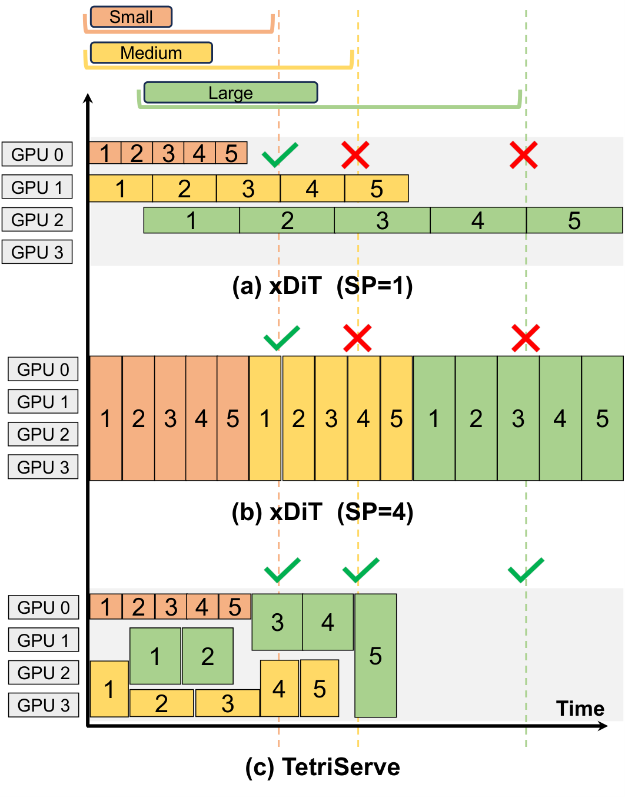

# TetriServe: Serve your DiT models like Tetris! 🧩

<p align="center">
  <a href="https://arxiv.org/abs/2510.01565"></a>
  <a href="https://asplos-conference.org/2026/"></a>
  <a href="LICENSE"></a>
  <a href="https://www.python.org/downloads/"></a>
  
</p>

<p align="center">
  <b>Multi-GPU diffusion model serving with dynamic GPU allocation and SLO-aware scheduling.</b><br>
  Pack inference requests like Tetris — maximize GPU utilization, meet latency SLOs.
</p>

---

## Overview

TetriServe is a serving system for diffusion models (FLUX, SD3) that dynamically allocates GPUs per request using sequence-parallel inference. Rather than fixing a static degree of parallelism, TetriServe assigns each request the optimal number of GPUs at runtime based on its resolution and latency SLO — achieving **up to 32% higher SLO attainment** than fixed sequence-parallel baselines.

**Key ideas:**
- 🔲 **Dynamic GPU allocation** — each request gets the right number of GPUs based on resolution × latency SLO
- ⚡ **SLO-aware scheduling** — `dyn_slo_schedule_global_dp` packs requests to maximize SLO attainment
- 📐 **Supports FLUX and SD3** on multi-GPU clusters (tested on 8× H100 80GB, 4× A40 48GB)

<p align="center">
  <!-- 
  <br> -->
  
  <br>
  <em>Three DiT requests with different resolutions and SLOs. Fixed sequence parallelism (xDiT SP=1, SP=4) misses multiple deadlines. TetriServe packs requests like Tetris 🧩, adapting SP, and meets all SLOs.</em>
</p>

---

## Results

Evaluated on FLUX.1-dev (8× H100 80GB) and SD3 (4× A40 48GB) against fixed sequence-parallel baselines (xDiT SP=1/2/4/8) and a resolution-specific SP oracle (RSSP).

**SLO Attainment Ratio (SAR) — FLUX on 8× H100:**

| SLO Scale | Best Baseline (SAR) | TetriServe (SAR) | Gain |
|:---------:|:-------------------:|:----------------:|:----:|
| 1.0×      | ~74%                | ~76%             | +2pp |
| 1.1×      | ~65%                | ~83%             | **+28%** |
| 1.2×      | ~69%                | ~91%             | **+32%** |
| 1.5×      | ~80%                | ~95%             | +15pp |

- **+10% avg SAR** over best baseline on Uniform workload mix
- **+15% avg SAR** over best baseline on Skewed (large-resolution-heavy) workload mix
- Gains are largest at tight SLOs (1.0×–1.2×) where fixed SP is most constrained

See the [paper](https://arxiv.org/abs/2510.01565) for full evaluation details, ablation studies, and A40/SD3 results.

---

## Installation

**Requirements:** Python 3.10+, CUDA 12.4+, 2+ NVIDIA GPUs

```bash
git clone https://github.com/DiT-Serving/TetriServe && cd TetriServe

# Create venv and install
uv venv .venv --python 3.10
uv pip install -p .venv torch==2.6.0 --index-url https://download.pytorch.org/whl/cu124
uv pip install -p .venv -e ".[diffusers]"
uv pip install -p .venv --no-build-isolation "flash-attn==2.6.3"

# Verify
uv run --no-sync python -c "import tetriserve; print('OK')"
```

<details>
<summary>Docker</summary>

```bash
docker build -t tetriserve .

docker run --gpus all --ipc=host --network host --rm \
  -v $(pwd):/workspaces/TetriServe \
  -v ~/.cache/huggingface:/root/.cache/huggingface \
  tetriserve
```

</details>

---

## Quick Start

```bash
# Login to HuggingFace (for model weights)
huggingface-cli login

# Launch TetriServe (4 GPUs, SD3)
uv run --no-sync python -m tetriserve.server.launcher \
  --nnodes 1 --nproc_per_node 4 \
  --master_addr 127.0.0.1 --master_port 1037 \
  --perf_model_dir log/benchmark/scaling_efficiency/ \
  --schedule_logic "fcfs_optimal_shape" \
  --output_type 'pil' \
  --model "stabilityai/stable-diffusion-3-medium-diffusers"
```

**Send a request:**

```bash
curl -X POST "http://localhost:1037/v1/generate" \
  -H "Content-Type: application/json" \
  -d '{
    "prompt": "A beautiful sunset over mountains",
    "height": 1024, "width": 1024,
    "num_inference_steps": 20,
    "latency_threshold": 16
  }'
```

---

## Benchmarking

Reproduce the paper results on 8× H100:

```bash
# Baseline (data-parallel, fixed SP)
python benchmark/serving_benchmark/benchmark_serving.py \
  --config benchmark/serving_benchmark/configs/benchmark_flux_H100_baseline.yaml

# TetriServe (dynamic SLO-aware scheduling)
python benchmark/serving_benchmark/benchmark_serving.py \
  --config benchmark/serving_benchmark/configs/benchmark_flux_H100_tetris_dp.yaml
```

Configs are also provided for A40, L40 and SD3. See [`benchmark/serving_benchmark/configs/`](benchmark/serving_benchmark/configs/).

---

## Documentation

- [Architecture overview](doc/architecture.md)
- [API reference](doc/api_reference.md)
- [Benchmark system](doc/benchmark.md)

---

## Citation

```bibtex
@inproceedings{tetriserve2026,
  title     = {TetriServe: Efficiently Serving Mixed DiT Workloads},
  author    = {Runyu Lu and Shiqi He and Wenxuan Tan and Shenggui Li and Ruofan Wu and Jeff J. Ma and Ang Chen and Mosharaf Chowdhury},
  booktitle = {The 31st ACM International Conference on Architectural Support for Programming Languages and Operating Systems (ASPLOS'26), Volume 2},
  year      = {2026},
  url       = {https://arxiv.org/abs/2510.01565}
}
```

---

## Acknowledgements

TetriServe builds on the following open-source projects:

- [xDiT 0.4.3](https://github.com/xdit-project/xDiT) — sequence-parallel DiT inference
- [vLLM](https://github.com/vllm-project/vllm) — serving system design patterns
- [SGLang](https://github.com/sgl-project/sglang) — scheduler design
